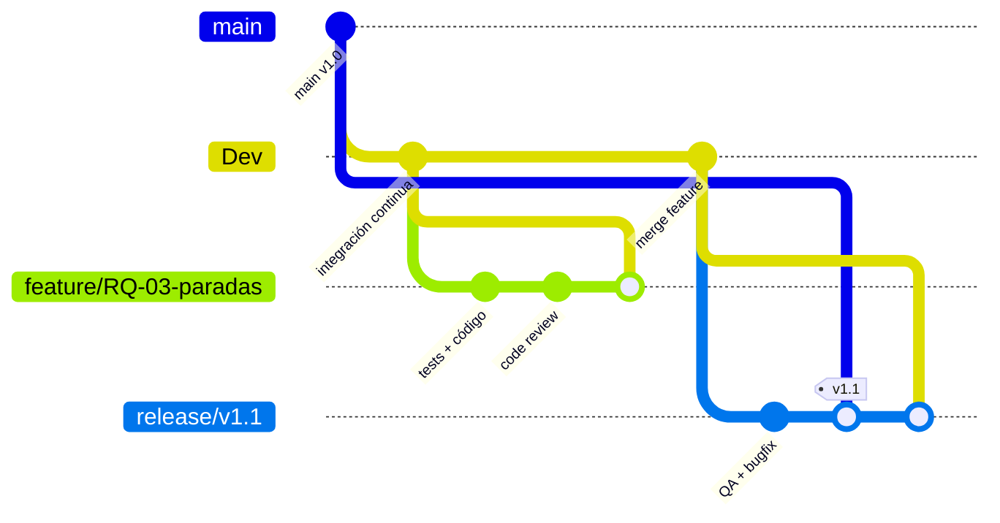

# Documento de Instrumentos de Calidad de Software — Pal' Monte

**Proyecto:** Pal' Monte — App web de ciclistas (Ibagué) + App móvil Android
**Evidencias SENA ADSO:** GA8-220501096-AA1-EV01 (web), AA2-EV02 (APK), AA2-EV03 (taller)
**Fecha:** 2026-11-07
**Versión:** 1.0

---

## 1. Análisis del Componente Formativo

### 1.1 Competencia asociada
> **Aplicar buenas prácticas de calidad documentadas en las disciplinas de calidad de software**, optimizando actividades de desarrollo, garantizando documentación técnica accesible y reduciendo la curva de aprendizaje.

### 1.2 Resultados de aprendizaje esperados
| RA | Descripción |
|---|---|
| RA1 | Diseñar instrumentos de calidad de software |
| RA2 | Seleccionar buenas prácticas según marcos de referencia (ISO 25010, CMMI, SWEBOK, ISTQB) |
| RA3 | Aplicar proceso personal de desarrollo (PSP/TSP) para mejorar calidad |
| RA4 | Documentar el proceso de calidad de software |
| RA5 | Utilizar herramientas TIC para el diseño de instrumentos |

### 1.3 Alcance del proyecto analizado
- **Backend:** Python 3.11 + FastAPI + Uvicorn (puerto 8000) — `Backend-Js/`
- **Frontend:** HTML5 + CSS3 + JS vanilla (módulos: `main/`, `rutas/`, `eventos/`, `comercio/`, `sesion/`)
- **Base de datos:** MySQL 8 (servicio Windows) — 24 tablas, script `database/palmonte.sql`
- **Testing:** pytest + httpx + TestClient (carpeta `tests/`)
- **Mobile:** Android (Jetpack Compose, Kotlin) — código en `D:\Android\AppPedalea`, APK en `apk/`

---

## 2. Selección de Buenas Prácticas según Marcos de Referencia

### 2.1 Marco ISO/IEC 25010 (Calidad de producto)
| Atributo | Sub-atributos priorizados | Métricas propuestas |
|---|---|---|
| **Funcionalidad** | Adecuación, Exactitud, Cumplimiento | % casos de prueba pasados, defectos funcionales/KLOC |
| **Fiabilidad** | Disponibilidad, Tolerancia a fallos, Recuperabilidad | MTBF, % uptime, tiempo de recuperación |
| **Rendimiento** | Comportamiento temporal, Utilización de recursos | Tiempo respuesta API < 500ms (p95), CPU < 70%, RAM < 512MB |
| **Seguridad** | Confidencialidad, Integridad, Autenticación | Vulnerabilidades críticas/altas = 0, OWASP Top 10 cubierto |
| **Mantenibilidad** | Modularidad, Reutilizabilidad, Analizabilidad | Complejidad ciclomática < 10, cobertura tests > 80%, deuda técnica < 5% |
| **Portabilidad** | Adaptabilidad, Instalabilidad | Despliegue en Windows/Linux sin cambios, Dockerfile funcional |

### 2.2 Marco CMMI Nivel 2 (Gestión de proyecto y procesos)
| Área de proceso | Práctica aplicada en Pal' Monte |
|---|---|
| **Gestión de requisitos** | Trazabilidad: RA → User Story → Test Case (matriz en §5) |
| **Planificación del proyecto** | `PROJECT_CONTEXT.md` + `PLAN_DIVISION.md` (existentes) |
| **Monitoreo y control** | Kanban en GitHub Projects, daily standups documentados |
| **Aseguramiento de calidad** | Code review obligatorio (PR), CI/CD con GitHub Actions |
| **Gestión de configuración** | Git flow: `main` (prod), `Dev` (integración), `feature/*` |
| **Gestión de cambios** | Issues → PR → Review → Merge → Deploy |

### 2.3 SWEBOK (Guía del conocimiento de ingeniería de software)
| KA (Área de conocimiento) | Aplicación |
|---|---|
| **Requisitos** | Especificación en `README.md` + `PROJECT_CONTEXT.md` |
| **Diseño** | Arquitectura 3 capas documentada, diagramas en §3 |
| **Construcción** | Estándares PEP 8 (Python), ESLint/Prettier (JS), naming conventions |
| **Pruebas** | Pirámide: Unit (pytest) > Integración (httpx) > E2E (manual) |
| **Mantenimiento** | Versionado semántico, changelog, refactoring programado |
| **Gestión de configuración** | Git + GitHub, `.gitignore`, `.env.example` |

### 2.4 ISTQB (Pruebas de software)
| Nivel | Herramienta | Cobertura objetivo |
|---|---|---|
| **Unitarias** | pytest | 85% statements, 80% branches |
| **Integración** | pytest + httpx + TestClient | 100% endpoints críticos (auth, rutas, eventos, comercios) |
| **Sistema** | Postman / Thunder Client (`palmonte-thunder-client.json`) | Flujos completos: registro → login → crear ruta → inscribir evento |
| **Aceptación** | Checklist `docs/guia_evidencia.md` (15 pasos) | 100% criterios de aceptación EV01 |

---

## 3. Instrumentos de Calidad Diseñados

### 3.1 Matriz de Trazabilidad Requisitos–Pruebas (RTM)

| ID Requisito | Descripción | Módulo | Tipo prueba | Caso de prueba | Estado |
|---|---|---|---|---|---|
| RQ-01 | Registro de usuario con validación email/password | Auth | Unit + Integración | `test_registro_exitoso`, `test_registro_email_duplicado`, `test_registro_email_invalido`, `test_registro_password_corta` | ✅ |
| RQ-02 | Login con JWT/sesión y roles | Auth | Unit + Integración | `test_login_exitoso`, `test_login_contrasena_incorrecta`, `test_login_email_inexistente` | ✅ |
| RQ-03 | CRUD rutas con geometría (puntos/paradas) | Rutas | Integración | `test_rutas.py` (pendiente ampliar) | 🔄 |
| RQ-04 | Inscripción/cancelación eventos con cupos | Eventos | Integración | `test_eventos.py` | 🔄 |
| RQ-05 | Reseñas 1–5 con promedio automático | Reseñas | Integración | `test_resenas.py` | 🔄 |
| RQ-06 | Admin: gestión usuarios/comercios/rutas | Admin | Integración | `test_admin.py` | 🔄 |
| RQ-07 | Frontend consume API sin CORS errors | Frontend | Sistema | Checklist manual `guia_evidencia.md` | ⏳ |
| RQ-08 | APK compila y conecta a API (10.0.2.2:8000) | Mobile | Sistema | `gradlew assembleDebug` + test emulador | ⏳ |

> **Leyenda:** ✅ Cubierto | 🔄 Parcial | ⏳ Pendiente

### 3.2 Checklist de Code Review (obligatorio en PR)

| Categoría | Criterio | Herramienta/Verificación |
|---|---|---|
| **Estilo** | PEP 8 (Python) / ESLint Airbnb (JS) | `flake8` / `eslint` en CI |
| **Seguridad** | Sin secrets hardcodeados, validación entrada, SQL injection prevention | `bandit`, revisión manual |
| **Pruebas** | Tests nuevos/actualizados para código nuevo | `pytest --cov` en CI |
| **Documentación** | Docstrings en funciones públicas, README actualizado | Revisión manual |
| **Complejidad** | Funciones < 50 líneas, ciclomática < 10 | `radon cc` / `eslint complexity` |
| **Performance** | Sin N+1 queries, índices BD en FK | `EXPLAIN` en queries críticas |
| **Accesibilidad (Frontend)** | Semantic HTML, contraste, labels en forms | `axe-core` en CI (futuro) |

### 3.3 Definición de Done (DoD) por tipo de entrega

| Entregable | Criterios DoD |
|---|---|
| **Backend (FastAPI)** | ✅ Tests pasan (unit + integración) • ✅ Cobertura > 80% • ✅ Linting OK • ✅ Docstrings • ✅ Swagger actualizado • ✅ Migración BD si aplica • ✅ Code review aprobado |
| **Frontend (HTML/JS/CSS)** | ✅ Sin errores consola • ✅ Responsive (mobile/desktop) • ✅ Accesibilidad básica • ✅ Conecta a API 3000/8000 • ✅ Code review aprobado |
| **Base de datos** | ✅ Script `palmonte.sql` ejecuta limpio • ✅ FK/CHECK/INDEX válidos • ✅ Datos demo cargan • ✅ Rollback documentado |
| **Mobile (Android)** | ✅ `assembleDebug` exitoso • ✅ Tests unitarios (JUnit) • ✅ Conecta a API local • ✅ APK firmado debug • ✅ Code review aprobado |
| **Documentación** | ✅ `README.md` actualizado • ✅ `PROJECT_CONTEXT.md` actualizado • ✅ Changelog • ✅ Diagramas si cambio arquitectura |

### 3.4 Métricas de Calidad (Dashboard objetivo)

| Métrica | Objetivo | Frecuencia medición | Herramienta |
|---|---|---|---|
| Cobertura de código (backend) | ≥ 85% | Cada PR | `pytest --cov=Backend-Js` |
| Complejidad ciclomática media | < 8 | Cada PR | `radon cc Backend-Js` |
| Deuda técnica (SonarQube) | < 5% | Semanal | SonarCloud / local |
| Vulnerabilidades críticas/altas | 0 | Cada PR + semanal | `bandit`, `npm audit`, Dependabot |
| Tiempo de respuesta API (p95) | < 500ms | Cada release | `locust` / `k6` |
| Defectos en producción / sprint | < 2 | Por sprint | GitHub Issues etiquetados `bug` |
| Tiempo medio de resolución (MTTR) | < 4h | Mensual | GitHub Issues analytics |

---

## 4. Proceso Personal de Desarrollo (PSP/TSP Adaptado)

### 4.1 Fases del proceso personal (PSP)

| Fase | Actividad | Entrada | Salida | Métrica personal |
|---|---|---|---|---|
| **Planificación** | Estimar tarea, definir tests, identificar riesgos | Issue/User Story | Plan de tarea + estimación (horas) | % error estimación vs real |
| **Diseño** | Especificar interfaz, pseudocódigo, casos de prueba | Plan | Documento diseño + lista tests | Defectos encontrados en diseño |
| **Codificación** | Implementar siguiendo estándares, tests primero (TDD opcional) | Diseño | Código + tests | Defectos inyectados/hora |
| **Revisión** | Auto-revisión con checklist §3.2 + tests locales | Código | Código revisado | Defectos encontrados en revisión |
| **Compilación/Test** | Ejecutar suite completa, corregir fallos | Código revisado | Build verde | % tests pasados en 1ra ejecución |
| **Post-mortem** | Registrar datos reales, analizar variaciones, mejorar estimación | Datos fase | Lecciones aprendidas | Mejora estimación próxima tarea |

### 4.2 Registro de tiempo personal (Time Log)

```markdown
# Time Log — Sprint actual
| Fecha | Fase | Tarea (Issue #) | Planificado (h) | Real (h) | Defectos inyectados | Defectos encontrados |
|---|---|---|---|---|---|---|
| 2026-11-07 | Planificación | #42 CRUD paradas ruta | 1.0 | 0.75 | 0 | 0 |
| 2026-11-07 | Diseño | #42 | 1.5 | 1.25 | 0 | 1 (caso borde) |
| 2026-11-07 | Codificación | #42 | 3.0 | 3.5 | 2 | 0 |
| 2026-11-07 | Revisión | #42 | 0.5 | 0.75 | 0 | 2 |
| 2026-11-07 | Test | #42 | 1.0 | 0.5 | 0 | 0 |
```
> **Plantilla disponible en:** `docs/templates/time_log.md`

### 4.3 Métricas personales objetivo
- **Precisión estimación:** ±20% (promedio últimos 10 tasks)
- **Densidad defectos inyección:** < 5 defectos/KLOC
- **Efectividad revisión personal:** > 60% defectos encontrados antes de PR
- **Tiempo en revisión vs codificación:** ≥ 15%

---

## 5. Documentación del Proceso de Calidad

### 5.1 Flujo de trabajo Git (Git Flow adaptado)



**Reglas:**
- `main` = producción (protegida, requiere 2 approvals + CI verde)
- `Dev` = integración (protegida, requiere 1 approval + CI verde)
- `feature/*` = una historia de usuario, vida corta (< 3 días)
- `hotfix/*` = solo desde `main`, merge a `main` y `Dev`
- Commits: **Conventional Commits** (`feat:`, `fix:`, `refactor:`, `test:`, `docs:`, `chore:`)

### 5.2 Pipeline CI/CD (GitHub Actions — `.github/workflows/ci.yml`)

```yaml
name: CI - Pal' Monte
on: [push, pull_request]
jobs:
  backend:
    runs-on: ubuntu-latest
    services:
      mysql:
        image: mysql:8
        env: { MYSQL_ROOT_PASSWORD: root, MYSQL_DATABASE: palmonte }
        ports: [3306:3306]
        options: --health-cmd="mysqladmin ping" --health-interval=10s --health-timeout=5s --health-retries=5
    steps:
      - uses: actions/checkout@v4
      - uses: actions/setup-python@v5
        with: { python-version: '3.11' }
      - name: Install deps
        run: |
          cd Backend-Js
          pip install -r requirements.txt -r requirements-testing.txt
      - name: Lint
        run: |
          cd Backend-Js
          flake8 . --max-line-length=100 --max-complexity=10
          bandit -r . -ll
      - name: Tests + Coverage
        run: |
          cd Backend-Js
          pytest ../tests -v --cov=. --cov-report=xml --cov-fail-under=85
      - name: Upload coverage
        uses: codecov/codecov-action@v4

  frontend-lint:
    runs-on: ubuntu-latest
    steps:
      - uses: actions/checkout@v4
      - uses: actions/setup-node@v4
        with: { node-version: '20' }
      - name: Lint HTML/JS/CSS
        run: |
          npx htmlhint main/*.html rutas/*.html eventos/*.html comercio/*.html sesion/*.html
          npx eslint main/*.js rutas/*.js eventos/*.js comercio/*.js sesion/*.js
```

### 5.3 Gestión de defectos (Bug Tracker)

| Campo | Descripción | Valores |
|---|---|---|
| **Severidad** | Impacto en usuario | Crítica / Alta / Media / Baja / Cosmética |
| **Prioridad** | Urgencia de corrección | P0 (inmediato) / P1 (24h) / P2 (sprint) / P3 (backlog) |
| **Estado** | Ciclo de vida | Abierto → En análisis → En desarrollo → En prueba → Cerrado |
| **Origen** | Dónde se detectó | Desarrollo / Code Review / QA / Producción / Usuario |
| **Categoría** | Tipo de defecto | Funcional / Rendimiento / Seguridad / Usabilidad / Documentación / Compatibilidad |

**SLA por severidad:**
- Crítica: fix en 4h (hotfix)
- Alta: fix en 24h
- Media: fix en sprint actual
- Baja: fix en próximo sprint

### 5.4 Revisiones de calidad programadas

| Reunión | Frecuencia | Participantes | Entradas | Salidas |
|---|---|---|---|---|
| **Sprint Planning** | Inicio sprint (2 sem) | Equipo completo | Backlog priorizado, capacidad | Sprint Backlog + estimaciones |
| **Daily Standup** | Diaria (15 min) | Equipo dev | Tablero Kanban | Impedimentos, ajustes |
| **Code Review** | Por PR | Autor + 1 reviewer mínimo | PR + checklist §3.2 | Aprobado / Cambios requeridos |
| **Sprint Review** | Fin sprint | Equipo + PO | Incremento completado | Feedback, aceptación |
| **Retrospectiva** | Fin sprint | Equipo dev | Métricas sprint, time logs | 3 mejoras accionables |
| **Quality Gate Release** | Pre-despliegue | Tech Lead + QA | Métricas §3.4, checklist DoD | Go / No-Go |

---

## 6. Herramientas TIC para Diseño y Gestión de Instrumentos

| Categoría | Herramienta | Uso en Pal' Monte | Licencia |
|---|---|---|---|
| **Control de versiones** | Git + GitHub | Repo principal, Issues, Projects, Actions | Gratis |
| **Gestión de proyecto/Calidad** | GitHub Projects (Kanban) | Backlog, sprint board, métricas | Gratis |
| **CI/CD** | GitHub Actions | Pipeline §5.2 | Gratis (2000 min/mes) |
| **Testing Backend** | pytest + httpx + TestClient | Tests unit/integración `tests/` | Open Source |
| **Testing Frontend** | htmlhint + eslint + (futuro: Playwright) | Lint + E2E | Open Source |
| **Testing Mobile** | JUnit + Espresso + Gradle | Unit + Instrumented tests | Open Source |
| **Cobertura** | coverage.py + Codecov | Dashboard cobertura | Freemium |
| **Análisis estático** | flake8 + bandit + radon (Py) / eslint (JS) | Calidad código, seguridad, complejidad | Open Source |
| **Base de datos** | MySQL Workbench / DBeaver | Modelado, queries, administración | Gratis |
| **API Testing** | Thunder Client (VS Code) / Postman | Collection `palmonte-thunder-client.json` | Gratis |
| **Documentación** | Markdown + Mermaid (diagramas) | `README.md`, `PROJECT_CONTEXT.md`, este doc | Gratis |
| **Diagramas arquitectura** | Mermaid.js (en Markdown) / Draw.io | Diagramas §1.3, §5.1 | Gratis |
| **Métricas proceso** | GitHub Insights + Time Log personal | Velocidad, cycle time, estimación | Gratis |
| **Comunicación** | Discord / Teams / WhatsApp | Daily, dudas rápidas | Gratis |

### 6.1 Plantillas disponibles (carpeta `docs/templates/`)
```
docs/templates/
├── time_log.md              # Registro tiempo personal (PSP)
├── sprint_retrospective.md  # Formato retrospectiva
├── bug_report.md            # Formato reporte defecto
├── code_review_checklist.md # Checklist §3.2
├── definition_of_done.md    # DoD §3.3
└── release_checklist.md     # Quality Gate pre-release
```

---

## 7. Plan de Mejora Continua (Próximos 3 Sprints)

| Sprint | Objetivo de calidad | Acciones | Responsable | Métrica éxito |
|---|---|---|---|---|
| **Sprint 1** | Consolidar testing backend | Ampliar `tests/` a 100% endpoints críticos, CI verde | Dev Backend | Cobertura ≥ 85%, 0 tests flaky |
| **Sprint 2** | Calidad frontend + accesibilidad | ESLint/Prettier config, htmlhint, axe-core básico | Dev Frontend | 0 errores lint, 0 violaciones WCAG AA críticas |
| **Sprint 3** | Mobile + Performance | Tests Android, k6 load testing API, SonarCloud | Full Stack | APK compila, p95 < 500ms, 0 vulnerabilidades altas |

---

## 8. Anexos

### A. Glosario
- **KLOC:** Miles de líneas de código
- **MTBF:** Mean Time Between Failures
- **MTTR:** Mean Time To Recovery
- **PSP:** Personal Software Process
- **TSP:** Team Software Process
- **DoD:** Definition of Done
- **RTM:** Requirements Traceability Matrix

### B. Referencias
- ISO/IEC 25010:2011 — Systems and software quality requirements and evaluation
- CMMI Institute — CMMI for Development, Version 2.0
- IEEE Computer Society — SWEBOK Guide v3.0
- ISTQB — Certified Tester Foundation Level Syllabus 2018
- Humphrey, W. — "A Discipline for Software Engineering" (PSP/TSP)
- OWASP Top 10 2021
- Guía de evidencias SENA ADSO — GA8-220501096

---

**Fin del documento**

> **Nota:** Este documento es vivo. Actualizar en cada retrospectiva y quality gate. Versión en control de versiones: `git log DOCUMENTO_CALIDAD_SOFTWARE.md`.